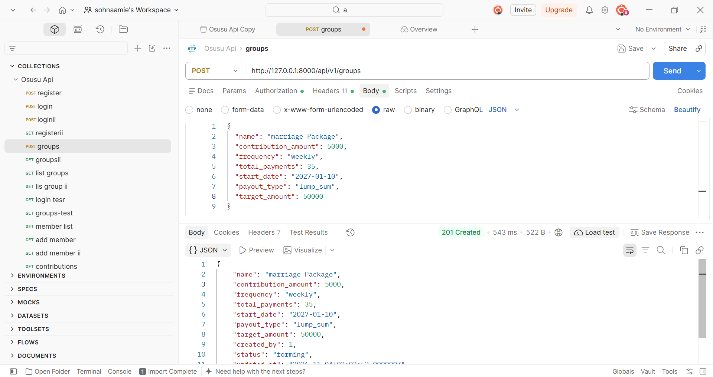
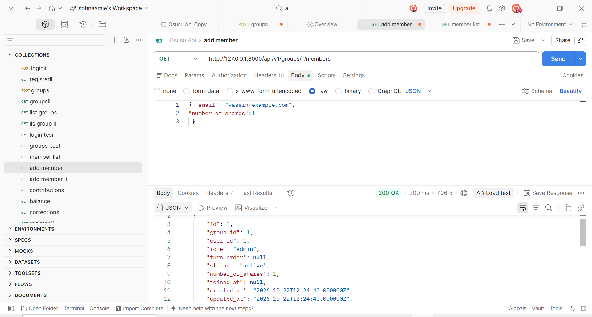
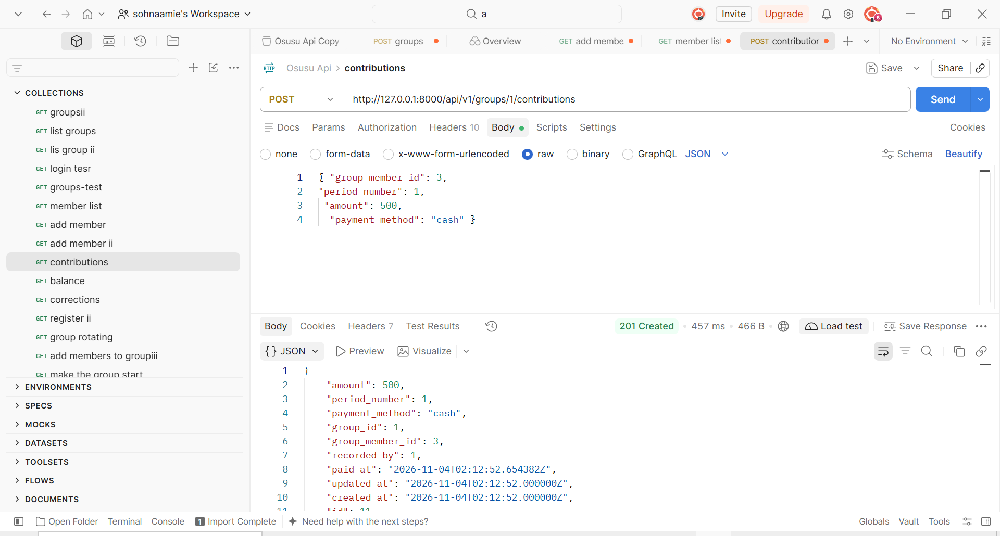
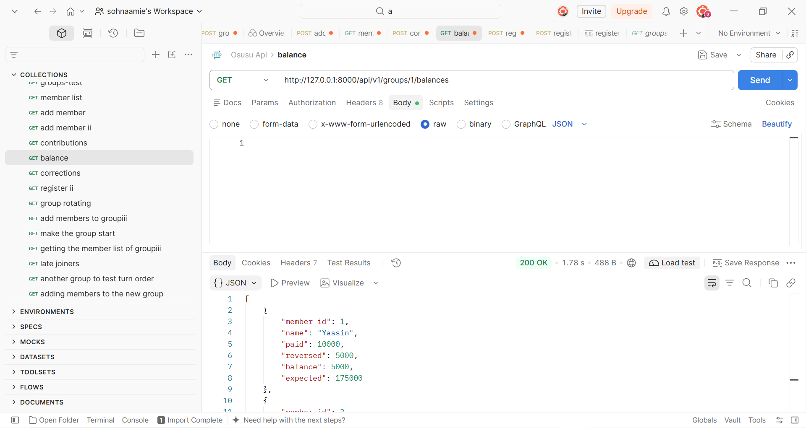

# Osusu API

A Laravel REST API for managing osusu (savings) groups. It supports any kind of osusu: weekly or monthly payments, a rotating payout where one member collects each period, or a lump sum at the end (like a Ramadan package).

## Features
- Token authentication (Laravel Sanctum), with rate limits on login and register
- Groups with configurable amount, frequency, length and payout type
- Roles per group: admin and member (the same person can be admin in one group and member in another)
- Random turn order for rotating groups, one turn per share, with late joiners supported
- Payments stored as an append-only history; balances are calculated, never stored
- Corrections instead of edits or deletes, so the audit trail is kept
- Rotating payouts (full pot required) and lump sum settlement (items or refunds)
- Policies: outsiders get 404, plain members get 403

## Tech
- Laravel 13.35.0
- PHP 8.5
- SQLite (development)
- Tests: PHPUnit (16 tests, 84 assertions)

## Run locally
```bash
composer install
cp .env.example .env
php artisan key:generate
php artisan migrate
php artisan serve
php artisan test
```

To build turn rounds on a schedule, run `php artisan schedule:run` every minute from cron. A single command can also be run by hand: `php artisan osusu:build-rounds`.

## Endpoints
All routes are under `/api/v1`. Send `Accept: application/json`. Routes marked "logged in" or higher need an `Authorization: Bearer <token>` header.

| Method | URL | Who | Purpose |
|---|---|---|---|
| POST | /register | anyone | create account, returns token |
| POST | /login | anyone | returns token |
| POST | /logout | logged in | revoke current token |
| GET | /groups | logged in | your groups |
| POST | /groups | logged in | create group (you become admin) |
| GET | /groups/{id} | member | group details |
| GET | /groups/{id}/members | member | member list |
| POST | /groups/{id}/members | admin | add a member by email |
| POST | /groups/{id}/start | admin | start group, assign turns |
| POST | /groups/{id}/contributions | admin | record a payment |
| POST | /groups/{id}/contributions/{cid}/corrections | admin | reverse a payment (full or partial) |
| GET | /groups/{id}/balances | member | paid, reversed, balance, expected |
| POST | /groups/{id}/payouts | admin | pay out a period (rotating groups, pot must be full) |
| GET | /groups/{id}/payouts | member | list payouts for the group |
| POST | /groups/{id}/settle | admin | settle a lump sum group |
| GET | /groups/{id}/behind | admin | members who have not reached the target |

## Design decisions
- **Rules are data, not code.** Amount, frequency, length and payout type are columns, so one system handles every kind of osusu.
- **Whole dalasi.** Money is stored as whole dalasi integers. Decimals are rejected, so amounts like D12.50 are not supported.
- **Balances are calculated, not stored.** Two copies of the same number can disagree, and then nobody knows which is right.
- **Corrections are a separate table.** This keeps the payment history clean and every mistake visible.
- **Constraints and locks, not only PHP checks.** PHP cannot see another request happening at the same moment, but the database can.
- **Role belongs to the membership**, not the user.
- **Mass assignment is blocked** for fields like `created_by`, `status`, `role` and `recorded_by`, so clients cannot set them.
- **Outsiders get 404**, so they cannot learn which groups exist.

## Turns
- One turn per share, in random order at start.
- Late joiners are placed randomly among future turns, so they do not wait behind earlier members. They owe all past periods (catch-up payments).
- A new round is built automatically when turns run out, and also by a daily scheduled command.

## Lump sum
- One target amount for the whole group; every member must reach it.
- On the day the admin chooses, members who reached the target share the items bought with the pool, and everyone else gets an exact refund.
- One settlement per group. Only the admin can see who is behind.

## Known limitations
- Money is whole dalasi only.
- Payouts are only implemented for rotating groups; lump sum uses settlement.
- No notifications or reminders yet.
- API tokens expire after 7 days (configurable with SANCTUM_EXPIRATION).
- The scheduler needs a cron line on a real server.


## Example request
Create a group (Ramadan package style):

`POST /api/v1/groups`
```json
{
  "name": "Ramadan Package",
  "contribution_amount": 50,
  "frequency": "weekly",
  "total_payments": 35,
  "start_date": "2027-01-10",
  "payout_type": "lump_sum",
  "target_amount": 1750
}
```

Response `201`:
```json
{
  "name": "Ramadan Package",
  "contribution_amount": 50,
  "frequency": "weekly",
  "total_payments": 35,
  "start_date": "2027-01-10",
  "payout_type": "lump_sum",
  "target_amount": 1750,
  "created_by": 1,
  "status": "forming",
  "id": 7
}
```

A Postman collection with all requests is in `docs/`.


## Screenshots

### Create a group


### Add a member


### Record a payment


### Balances
